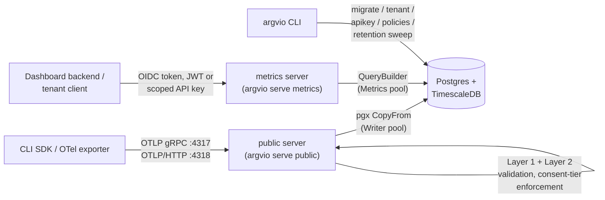

# Architecture

Argvio's data component is one Go module and one binary, `argvio`
(`cmd/argvio`), whose subcommands run two independent server processes
sharing a Postgres/TimescaleDB storage layer:

- **`argvio serve public`** — the OTLP ingest edge. Internet-facing,
  high-volume, write-heavy, untrusted input.
- **`argvio serve metrics`** — the query/analysis API. Internal/
  trusted-tenant-facing, low-volume, read-heavy.

## Why two processes, not two goroutines

Ingest must stay up and fast even when analytics queries are slow or the
query server is being redeployed, and a runaway/expensive analytical query
must never backpressure or degrade ingest. Both servers ship from the same
`argvio` binary, but `serve public` and `serve metrics` still run as
separate processes — splitting at the process level, not just logically
within one running program, means:

- **Separate failure domains.** `metrics` can crash, OOM, or be redeployed
  without `public` even noticing.
- **Separate connection pools** (`internal/config.StorageConfig.PublicPool`
  vs `MetricsPool`) — a slow dashboard query can never starve ingest of a
  Postgres connection, because it's drawing from a different pool entirely.
- **Separate scaling.** `public`'s traffic is proportional to CLI
  invocations across every tenant's users; `metrics`'s traffic is
  proportional to dashboard views. These do not scale together.
- **Separate network exposure.** `public` sits on the internet edge;
  `metrics` does not need to, and shouldn't.

## `public`: OTLP receiver

Implements the OTLP spec for metrics, logs, and traces over both gRPC
(`OTLP/gRPC`) and HTTP (`OTLP/HTTP`, protobuf and JSON), using
`go.opentelemetry.io/collector/pdata` and the generated
`go.opentelemetry.io/proto/otlp` types rather than hand-rolling the wire
format. Built against pdata v1.64.0 / the OTLP proto definitions vendored
at that version (see `go.mod`).

Request pipeline (`internal/otlp`), every stage assuming a hostile or buggy
client:

1. **Auth** (`internal/otlp/core.go`, via `internal/authn.Verifier`) —
   accepts whichever of the globally-configured auth methods
   (`internal/config.AuthConfig`, shared with `metrics` — see below) are
   enabled: a scoped tenant API key (`internal/tenant.Cache`, an in-memory
   TTL cache in front of Postgres) and/or a user JWT/OIDC token, so e.g. a
   generic ingest key and a dashboard user's browser can both reach the
   same ingest endpoint. Either way the caller's tenant is re-resolved
   (not just trusted from a token claim) so an unknown/revoked key or a
   suspended tenant is rejected before any OTLP parsing happens, and a
   retry storm never reaches Postgres.
2. **Rate limiting** (`internal/ratelimit`) — per-(tenant, auth method)
   token buckets (requests/sec and bytes/sec), checked immediately after
   auth. A JWT/OIDC-authenticated caller gets its own bucket and, if
   configured (`public.jwt_rate_limit_*`), its own defaults — independent
   from the api_key tier, since an end user's browser and a service's
   ingest key don't scale the same way.
3. **Layer 1: structural validation** (`internal/otlp/limits.go`,
   `attrs.go`) — batch size, attribute count/length, timestamp skew, all
   from config, not hardcoded. A batch-size violation rejects the whole
   request; a per-attribute bound violation drops that attribute and keeps
   the record.
4. **Layer 2: semantic allowlist + consent tier** (`internal/allowlist`,
   `internal/consent`) — the record's event name must be on the versioned
   allowlist (or the whole record is rejected); its declared consent tier
   is capped at the tenant's configured ceiling; fields above the effective
   tier are stripped. See docs/allowlist.md.
5. **Write** (`internal/storage.Writer`) — accepted rows are batched per
   OTLP export request and written via `pgx.CopyFrom`.

Every rejection (whole-record or per-attribute) is logged with the reason
and the offending key names — never the raw values, since an unrecognized
or over-tier attribute may itself be the sensitive thing being rejected.

Responses use OTLP's `PartialSuccess` mechanism: an export request that's
partially accepted returns 200/OK with `rejected_spans` /
`rejected_data_points` / `rejected_log_records` populated, not a bare
failure. A whole-request structural rejection (oversized batch, disabled
signal type) returns the appropriate gRPC status
(`InvalidArgument`)/HTTP status (400) instead.

## `metrics`: query/analysis API

REST, not GraphQL — see the doc comment on `internal/metricsapi` for the
tradeoff. Every query is built through
`internal/storage.QueryBuilder`, which only accepts a `storage.TenantScope`
(constructed once, immediately after auth resolves the caller's tenant) —
there is no method on `QueryBuilder` that can run without one, so tenant
isolation is a type-system guarantee, not a code-review convention. See
docs/schema.md for what's backing each query.

Auth accepts whichever of the same globally-configured methods
(`internal/config.AuthConfig`, `auth.methods` — see `public`'s auth
section above) are enabled, scoped here to a `scope=metrics_query` API key
(distinct from `public`'s ingest keys) instead of `public_ingest`. The
bearer token is opaque to the dashboard; `internal/authn.Verifier` picks how to
verify it from its shape, not by trying each method in turn:

| Token | Method | Verified by |
|---|---|---|
| starts with `argv_` | `api_key` | hash lookup in `api_keys` |
| three-part JWS, HS256 | `jwt` | the shared HMAC secret, `tenant_id` claim |
| three-part JWS, RS*/PS*/ES* | `oidc` | `internal/oidc`: the provider's JWKS |
| anything else, introspection enabled | `oidc` | `internal/oidc`: RFC 7662 introspection |
| anything else, introspection disabled | `api_key` | as before |

`internal/oidc` relies only on OIDC discovery metadata and the RFCs
(6750, 7519, 7662, 9068). It checks `iss` (exactly as the discovery document
states it), `aud` (the API's resource identifier, deliberately never an SPA's
client_id, which is what keeps an ID token from passing as an access token),
`exp`/`nbf`, an optional `typ` of `at+jwt`, and any required scopes. JWT
signatures use the provider's JWKS (asymmetric algorithms only; refreshed on a
TTL and, rate-limited, when a token names an unknown `kid`). Opaque tokens go
to the provider's introspection endpoint; results are cached by
`sha256(token)` for `min(cache_ttl, exp - now)` with concurrent lookups
sharing one call, so **revocation at the provider takes up to
`auth.oidc.introspection.cache_ttl` to be noticed**.

**Tenants come from memberships, not claims.** An OIDC identity is
resolved from its verified `(iss, sub)` through the `tenant_members` table
(`argvio tenant member add|remove|list`), so one user can belong to several
tenants and access can be revoked without waiting for a token to expire.
With one membership the request uses it; with several the dashboard sends
`X-Argvio-Tenant` (the choices come from `GET /v1/tenants`), and no header
gets `400 tenant_required`. The header only chooses among tenants the caller
already owns: anything else is `403 no_tenant_access`, and the
`storage.TenantScope` is still derived solely from the resolved identity. A
`tenant_id` claim, if a token carries one, must itself be a membership
(`auth.oidc.trust_tenant_id_claim` is an explicit, default-off opt-out).
The legacy `jwt` method is unchanged.

**Errors tell the dashboard what to do.** `401` +
`WWW-Authenticate: Bearer error="invalid_token"`: re-authenticate. `403`
(`no_tenant_access`, `insufficient_scope`): authenticated but not allowed;
re-authenticating cannot help. `503`: the identity provider (discovery, JWKS or
introspection) is unreachable, which is a statement about the provider, never
about the token, so it is never a 401. Tokens are never logged; only `iss`,
`sub` and `jti`.

**Browser access.** The dashboard is a SPA on another origin, so
`metrics.cors.allowed_origins` (empty = off) enables CORS for exact origins,
registered ahead of authentication so the token-less preflight succeeds.
No wildcards, no credentials, GET only.

`public` runs the same verifier, but only accepts what `auth.methods` lists,
which by default is `api_key` and `jwt`; OIDC there is opt-in, and ingest has
no tenant selector, so an OIDC identity must have exactly one membership to
ingest. Full endpoint/parameter/response reference: `openapi/openapi.yaml`.

## OTLP spec version

Built against `go.opentelemetry.io/proto/otlp` v1.11.0 / `pdata` v1.64.0
(see `go.mod` for exact pinned versions). `public` does not ship its own
OpenAPI spec — it's OTLP-spec-compliant by definition, not a bespoke REST
API.

## Non-goals (out of scope for this component)

No frontend/dashboard UI, no billing/plan enforcement, no tenant
onboarding UI (use the `argvio` operator CLI), no CLI-side SDK/exporter
code.
