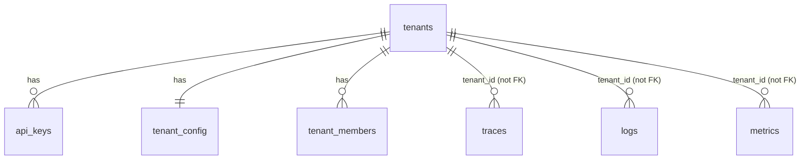

# Schema

Migrations live in `migrations/` (plain numbered `.sql` files, run via
`golang-migrate`'s pgx driver — `internal/storage/migrate.go` embeds them
so `argvio migrate` needs no external tooling). Requires the
`timescaledb` **and** `timescaledb_toolkit` Postgres extensions — see
"Deployment prerequisite" below.

## `tenants`, `api_keys`, `tenant_config`, `tenant_members` (`migrations/0001`, `0007`)

Plain (non-hypertable) tables — low volume, read on every ingest request
(via `internal/tenant.Cache`, never Postgres directly on the hot path).

| Table | Purpose |
|---|---|
| `tenants` | Identity: `id`, `slug`, `name`, `status` (active/suspended). |
| `api_keys` | `key_hash` (SHA-256; the raw key is shown once at creation and never stored), `key_prefix` (for admin display), `scope` (`public_ingest` or `metrics_query` — an ingest key cannot authenticate against `metrics`, and vice versa), `revoked_at`. |
| `installs` (`migrations/0006`) | One row per `cli.install_id`: `first_seen`/`last_seen`, first and last CLI version, last os/arch, vendor-reported `install_method`, `first_command_at` and `first_success_at` (first `cli.command.completed`, and first with exit code 0). Maintained at ingest from `cli.session.started` and `cli.command.completed` logs (`internal/storage/installs.go`), so first-run, activation time and upgrades don't go wrong when raw logs age out. Only basic-tier-or-above records carry an install id, so anonymous sessions never appear. Purged by `argvio retention sweep` once `last_seen` passes the tenant's logs retention. |
| `install_version_changes` | Append-only upgrade/downgrade log per install (`at`, `from_version`, `to_version`, `direction`), decided at ingest by comparing semver. Changes involving a version that doesn't parse as semver are not recorded. |
| `install_discoveries` (`migrations/0008`) | First use per `(tenant_id, install_id, kind, name)`: `kind` is `feature` (from `cli.feature.activated`, named by `cli.activation.feature`) or `flag` (each name in `cli.flag.names` of a `cli.command.invoked`), and `first_at` is the earliest sighting. Maintained at ingest (`internal/storage/discoveries.go`); time to discovery is `first_at` minus `installs.first_seen`. Kept as long as the install is, not as long as the raw logs. |
| `error_reasons` / `error_reason_overflow` (`migrations/0012`) | The per-tenant vocabulary of `cli.error.reason` values (`first_seen`, `last_seen`), capped at `public.max_error_reasons_per_tenant`, and how many records were stored as `other` because the cap was reached (`folded_count`, `last_folded_at`). Maintained at ingest before the rows are written (`internal/storage/error_reasons.go`); admitting new reasons takes a per-tenant advisory lock so concurrent batches can't overshoot the cap. `last_seen` moves forward at most once a day per reason; `argvio retention sweep` drops reasons unseen for the logs retention window. See docs/allowlist.md "Error reasons". |
| `counter_names` / `counter_labels` / `counter_overflow` (`migrations/0013`) | The same guard for vendor counters (`cli.counter`): each tenant's counter names, capped at `public.max_counter_names_per_tenant`, the labels seen under each name, capped at `public.max_counter_labels_per_name` per name, and how many data points were stored under `other` because a cap was reached (`folded_names`, `folded_labels`, `last_folded_at`). Maintained at ingest before the rows are written (`internal/storage/counters.go`) under a per-tenant advisory lock, touched at most once a day per value, swept by `argvio retention sweep` on the logs retention window (a label goes with its name). See docs/allowlist.md "Vendor counters". |
| `measure_names` / `measure_labels` / `measure_overflow` (`migrations/0014`) | The same guard again for vendor measures (`cli.measure`), with its own caps (`public.max_measure_names_per_tenant`, `public.max_measure_labels_per_name`) and tables, so counters and measures don't compete for slots. Maintained at ingest by the same code as the counter vocabulary (`internal/storage/counters.go`, `measures.go`). See docs/allowlist.md "Vendor measures". |
| `tenant_members` (`migrations/0007`) | Which OIDC identities may use a tenant: primary key `(tenant_id, issuer, subject)`, plus `role` (default `viewer`) and `created_at`. `issuer` is compared byte for byte with the token's `iss`, so it must be the provider's discovery `issuer` exactly (trailing slash included). A user's tenant is resolved from this table by the *verified* `(iss, sub)`, never from a token claim; one identity may belong to many tenants. Managed with `argvio tenant member add\|remove\|list`; servers cache lookups for up to their tenant cache TTL. |
| `tenant_config` | Runtime-tunable per-tenant overrides: `tier_ceiling`, `tier_enforcement_mode` (`strip`/`reject`), rate-limit overrides, retention-day overrides. One row per tenant, mutated via `argvio tenant config`, never via static config files. |

`traces`/`logs`/`metrics` deliberately have **no foreign key** to
`tenants(id)` — FK validation on every row would add lock/lookup overhead
to the hottest write path in the system, and tenant existence is already
enforced upstream by `public`'s API-key lookup before any row is written.

## `traces`, `logs`, `metrics` (`migrations/0002`) — the hypertables

One row per span / log record / metric data point — close to the OTLP data
model (resource → scope → record), not flattened, but with the columns
every query actually filters/aggregates on pulled out of JSONB into real,
indexed columns:

`tenant_id`, `time`, `cli_version`, `os`, `arch`, `command_name`,
`exit_code`, `is_ci`, `consent_tier` — present on all three tables.
`traces` additionally promotes `peak_rss_bytes` and `cpu_time_ms` (process
resource usage, `migrations/0009`) so a rollup can sketch them; `NULL` means
"not reported". Ingest (`internal/otlp/usage.go`) stores zero, negative and
implausibly large values as `NULL`, so one faulty client can't skew percentiles.
`logs` additionally promotes `binary_size_bytes` and `startup_ms` (build
footprint, `migrations/0010`), carried on `cli.session.started` only; same
`NULL` convention, with bounds in the same file (size above 0 and at most
4 GiB; startup 0 to 1 hour, zero being a real sub-millisecond start).
`logs` also carries `error_fingerprint` (`migrations/0011`), the failure-cause
grouping key of a `cli.error.raised` event (see "Error fingerprints" below);
`NULL` on every other event.
Everything else lives in JSONB (`resource_attributes` + one of
`span_attributes` / `log_attributes` / `datapoint_attributes`), with a GIN
index on each for ad hoc attribute filtering (`internal/otlp/pipeline.go`'s
`splitRemainingAttrs` is what decides promoted-column vs. JSONB per
attribute, driven by the allowlist schema).

Each is a **hypertable**, chunked by `time` (`chunk_time_interval` = 1 day)
and **space-partitioned by `tenant_id`** via `add_dimension` (8 hash
buckets — see "Tenant partitioning" below), since every query the metrics
server issues is tenant-scoped.

### Tenant partitioning

`add_dimension('traces', 'tenant_id', number_partitions => 8)` hashes
`tenant_id` into 8 buckets — **not** a 1-tenant-per-chunk mapping (that
doesn't scale as tenant count grows), but enough that the planner can
exclude chunks outside a queried tenant's bucket for the always-tenant-
scoped queries `QueryBuilder` issues. Revisit the bucket count as tenant
cardinality grows; changing it requires a new dimension (existing chunks
keep their original partitioning).

### Per-tenant retention

Timescale's `add_retention_policy` drops whole chunks past an age
threshold — but a chunk is time-range × tenant-hash-bucket, so it holds a
slice of *many* tenants. A retention policy therefore can only enforce one
(the longest-needed) window per hypertable, not a genuinely per-tenant one.

So: the global Timescale retention policy (`migrations/0004`, driven by
`StorageConfig.Traces/Logs/Metrics.RetentionAfter`) is the safety net sized
to the longest window any tenant needs. A tenant configured with a
*shorter* `tenant_config.retention_*_days` gets pruned early by
`argvio retention sweep` (`internal/storage.SweepTenantRetention`), a
plain `DELETE ... WHERE tenant_id = $1 AND time < now() - N days` — meant
to run on a schedule (cron/systemd timer), not wired to any request path.

## Continuous aggregates (`migrations/0003`)

Materialized views, `WITH (timescaledb.continuous)`, refreshed
hourly:

| View | Source | Grain | Backs |
|---|---|---|---|
| `cagg_command_stats_hourly` | `traces` (`cli.command.*` / `cli.subcommand.*` spans) | tenant × command × cli_version × os × arch × is_ci × hour | `LatencyPercentiles`, `ErrorRateSeries`, `CommandFrequency`, `CISplit` (bucket=hour) |
| `cagg_command_stats_daily` | `cagg_command_stats_hourly` (hierarchical) | same, × day | same four, bucket=day/week/month — avoids rescanning raw `traces` for wide-range dashboard queries; week/month re-bucket this at query time (`internal/storage/query.go`'s `rebucket`) rather than materializing yet another rollup |
| `cagg_exit_codes_hourly` (`migrations/0005`) | `traces` (same spans as above) | tenant × command × cli_version × os × arch × is_ci × exit_code × hour | `ExitCodeDistribution` — the command-stats rollups above only carry an errored/not-errored count, not a per-exit-code breakdown, hence a separate rollup rather than adding a column to `cagg_command_stats_*` |
| `cagg_command_resources_hourly` (`migrations/0009`) | `traces` (same spans as above) | tenant × command × cli_version × os × arch × is_ci × hour | `ResourceUsage` (bucket=hour): `percentile_agg` sketches of `peak_rss_bytes` / `cpu_time_ms` plus how many runs reported each. A separate rollup rather than new columns on `cagg_command_stats_*`, for the same reason as `cagg_exit_codes_hourly` |
| `cagg_command_resources_daily` | `cagg_command_resources_hourly` (hierarchical) | same, × day | `ResourceUsage`, bucket=day/week/month |
| `cagg_counters_hourly` (`migrations/0013`) | `metrics` (`cli.counter`, delta sums) | tenant × counter name × counter label × command × cli_version × os × arch × is_ci × hour | `CounterSeries` (bucket=hour): `sum(value)` as `total`, plus `datapoint_count`. Name and label are grouped straight out of `datapoint_attributes`; ingest caps their cardinality per tenant, which is what keeps this rollup bounded |
| `cagg_counters_daily` | `cagg_counters_hourly` (hierarchical) | same, × day | `Counters` (the per-name totals), `CounterSeries` bucket=day/week/month |
| `cagg_measures_hourly` (`migrations/0014`) | `metrics` (`cli.measure`, delta histograms) | tenant × measure name × measure label × command × cli_version × os × arch × is_ci × hour | `MeasureSeries` (bucket=hour): `sum(histogram_count)` as `measure_count`, `sum_ms`, `min_ms`, `max_ms`, `datapoint_count` and the 12 summed bucket counts `bkt_0`..`bkt_11`, one column per bucket of the fixed bounds ingest enforces (a continuous aggregate can't sum an array). Percentiles are interpolated from them in Go, never stored, so they stay correct when merged across hours, versions or labels |
| `cagg_measures_daily` | `cagg_measures_hourly` (hierarchical) | same, × day | `Measures` (the per-name statistics), `MeasureSeries` bucket=day/week/month |
| `cagg_session_activity_daily` | `logs` (`cli.session.started`) | tenant × cli_version × os × arch × is_ci × day | `SessionCohort`, `ActiveInstalls` (bucket=day/week/month) |
| `cagg_session_footprint_daily` (`migrations/0010`) | `logs` (`cli.session.started`) | tenant × cli_version × os × arch × is_ci × day | `VersionFootprint`: `percentile_agg` sketches of `binary_size_bytes` / `startup_ms`, size min/max, how many sessions reported each, and a HyperLogLog of the installs behind each. A separate rollup rather than new columns on `cagg_session_activity_daily`, for the same reason as `cagg_command_resources_hourly`. `VersionFootprint` merges it across the whole window (one row per version, ordered by semver in Go, `internal/storage/semver.go`) rather than bucketing by time |

`cagg_session_activity_daily` also carries `install_hll`, a HyperLogLog
sketch (`timescaledb_toolkit`'s `hyperloglog(8192, ...)`) of
`log_attributes ->> 'cli.install_id'` per row — `hyperloglog()` ignores
NULLs, so anonymous-tier sessions (no `cli.install_id`) count toward
`session_count` but not toward `ActiveInstalls`. Sketches union correctly
across days via `rollup()`, so a week/month distinct-install count is exact
in aggregate structure (approximate only in the ~1% HLL sense) rather than
a sum of daily counts, which would double-count an install active on
several days. `migrations/0005` rebuilt this view from scratch (rather than
just adding a column) because a continuous aggregate's `GROUP BY`/
aggregate list can't be altered in place — see that migration's comments
for the backfill step required after deploying it.

Percentiles use TimescaleDB Toolkit's `percentile_agg`/`approx_percentile`
(uddsketch-backed), not `percentile_cont` — continuous aggregates can only
incrementally combine aggregates that support partial-state rollup, which
`percentile_cont` doesn't; `percentile_agg` is purpose-built for this.
`rollup()` combines the sketch across the hourly→daily hierarchy and across
whatever dimensions a query collapses (e.g. filtering by `os` but not
`cli_version` sums across `cli_version` values within a bucket).

`internal/storage/query.go`'s `commandStats` is the one query all three of
`LatencyPercentiles`/`ErrorRateSeries`/`CommandFrequency` share — same
`GROUP BY`, different projection — rather than three near-duplicate SQL
strings. `CISplit` reads the same rollup, grouped by `is_ci` instead of
`command_name`.

`Retention` (cohort-by-first-seen retention grid) is the one dashboard
aggregate that reads raw `logs` rather than a continuous aggregate: an
install's first-seen bucket is a per-install minimum over all history, which
no time-bucketed rollup can answer without re-deriving it per query anyway.
It's therefore bounded by raw log retention (an install older than that
looks "new" the next time it's seen), not by any cagg's longer retention
window.

### Install state

Ingest folds each logs batch into `installs` right after the logs are stored.
A failure there is logged and does not fail the export (the logs are already
committed, and a rejection would make the client retry and duplicate them).
`argvio installs backfill [--days 90]` rebuilds the table from stored logs by
replaying them oldest first through the same code; run it once after
migrating to 0006. Rerunning is safe, but can't recover version changes older
than what live ingest has since recorded.

Events may arrive out of order: late ones only move `first_seen`/
`first_version` earlier, and only events newer than the stored `last_seen`
update `last_*` fields or record a version change.

Discoveries follow the same shape: ingest upserts them right after the
installs, a failure is logged without failing the export, and `argvio installs
backfill` rebuilds them from retained logs (migrating to 0008 needs a rerun for
that). An earlier sighting moves `first_at` back; repeats and replays don't
touch the row.

`argvio retention sweep` deletes installs whose `last_seen` is older than the
tenant's `retention_logs_days`, or `--default-logs-days` (default 90, matching
`storage.logs.retention_after`) for tenants without an override. An install
that returns after that window is counted as new. The sweep deletes the
install's `install_discoveries` rows with it, plus any whose install has no
row once their own `first_at` passes the window.

### Error fingerprints

`GET /v1/metrics/error-fingerprints` groups `cli.error.raised` events into
failure causes by `logs.error_fingerprint`, computed once at ingest by
`internal/errfp` from the event's `cli.error.message` and
`cli.error.stacktrace`:

1. **Stack, when present.** The innermost 5 frames, innermost first (Python
   tracebacks, which list it last, are reversed). Each frame is reduced to
   its function and the base name of its file, so directories (home
   directories, temp and build dirs, module caches), line and column numbers
   and program-counter offsets drop out; both parts then go through the
   message normalizer below, which removes build hashes such as
   `chunk-3f2a9b1c.js`. Recognized layouts: Go tracebacks, Python
   tracebacks, `at fn (file:line:col)` (JavaScript, Java, .NET, Rust) and
   other `file.ext:line` locations (Ruby).
2. **Otherwise, the message**, with, in order, quoted strings, UUIDs, URLs,
   absolute paths (POSIX, `~/`, Windows drive and UNC), hex ids (`0x…`, or a
   run of 8+ hex digits mixing digits and letters) and numbers (including
   dotted/colon-separated ones and short units like `30s`) replaced by
   placeholders, and whitespace collapsed.
3. **Id**: the first 16 hex digits of SHA-256 over the algorithm version
   (`errfp.Version`), the source (`stack` or `message`) and the normalized
   lines. An event with neither a message nor a readable stack gets none.

Ingest-time rather than query-time: the normalizer is a format-aware parser,
cheap once per event in Go and expensive per query in SQL, and a stored key
can be indexed (`idx_logs_tenant_error_fingerprint_time`). The trade-off is
that the algorithm is fixed for stored rows: a change bumps `errfp.Version`
and only regroups events ingested afterwards, and events stored before
migration 0011 have no fingerprint and are not counted.

Privacy handling:

- Ingest fingerprints only what consent-tier stripping kept, so a fingerprint
  never encodes a message or stack the record's tier didn't allow storing.
  Both attributes are `full`, so only full-tier-or-above sessions contribute.
- At read time an event only counts if its stored `consent_tier` ranks at or
  below the tenant's **current** `tenant_config.tier_ceiling`, read in the
  same statement (not from the API-key cache), so lowering a ceiling hides
  detail stored under the old one immediately. The metrics server ranks
  tiers from the allowlist schema (`public.allowlist_schema_path`); a tenant
  with no config row or a ceiling the schema doesn't know sees nothing.
- The response never carries raw text: the representative `message` and
  `top_frame` are normalized from the fingerprint's most recent event and
  truncated to 512 characters.

## Compression + retention policies (`migrations/0004`)

| Table | Compress after | Retain (global) |
|---|---|---|
| `traces` | 7d | 30d |
| `logs` | 7d | 90d |
| `metrics` | 30d | ~400d |
| continuous aggregates | — | 90d (hourly rollups: `cagg_command_stats_hourly`, `cagg_exit_codes_hourly`, `cagg_command_resources_hourly`, `cagg_counters_hourly`, `cagg_measures_hourly`) / 730d (daily rollups, including `cagg_session_footprint_daily` `cagg_counters_daily` and `cagg_measures_daily`) |

Applied via migration at deploy time, and re-appliable idempotently via
`argvio policies apply` (`internal/storage.ApplyRetentionAndCompressionPolicies`)
whenever `StorageConfig`'s per-signal windows change — it removes then
re-adds each policy, since Timescale's `add_*_policy` doesn't update an
existing job's schedule in place. `compress_segmentby` is
`(tenant_id, command_name)` / `(tenant_id, event_name)` / `(tenant_id, metric_name)`
respectively, matching the columns dashboard queries actually filter by.

## Deployment prerequisite

Requires the `timescaledb` **and** `timescaledb_toolkit` Postgres
extensions available in the target environment — e.g. Timescale Cloud,
self-hosted with both extensions installed, or the
`timescale/timescaledb-ha` container image (bundles both; the plain
`timescale/timescaledb` image does not include Toolkit). `migrations/0002`
issues `CREATE EXTENSION IF NOT EXISTS` for both, so a mismatched
environment fails fast at `argvio migrate up`, not at first query.
